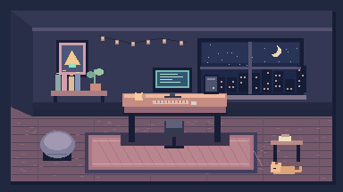

# Ещё один билд

Уютный пиксельный симулятор разработки игр для **Unity 6.6 (6000.6.7f1)** и Linux. Сделай свою первую игру, прочитай отзывы, улучши комнату и выпусти ещё один билд.



## Как открыть и запустить

1. На странице репозитория нажми **Code → Download ZIP**. Распакуй архив в свою домашнюю папку. Можно также выполнить `git clone https://github.com/Xelyphor/devgame.git`.
2. В **Unity Hub → Projects → Add → Add project from disk** выбери распакованную папку **devgame-main** (или **devgame** после клонирования). В ней должны находиться `Assets`, `Packages` и `ProjectSettings`. ZIP-файл выбирать не нужно.
3. Выбери установленный редактор **6000.6.7f1**. Дождись первого импорта. Для запуска в редакторе дополнительные модули платформ не нужны.
4. В Unity открой **Assets → OneMoreBuild → Scenes → Studio** двойным щелчком. Альтернатива: верхнее меню **Ещё один билд → Открыть игровую сцену**.
5. Нажми **Play ▶**. Вкладка **Game**, формат **16:9**, разрешение **1280×720** или **1920×1080**.
6. Нажми **«Придумать игру»**. Объекты, камера, интерфейс и звук создаются автоматически при запуске. В режиме редактирования сцена намеренно пустая.

Проект использует встроенный рендерер и встроенные модули Unity. URP, TextMesh Pro, Asset Store, отдельные шрифты и ручная привязка компонентов не требуются. Unity может дополнить отсутствующие настройки стандартными значениями при первом открытии — это нормально.

**Статус:** готова первая игровая версия в исходниках. Сам редактор Unity в облаке недоступен: импорт, запуск, сборка и визуальная проверка именно в 6000.6.7f1 ещё требуют проверки на компьютере пользователя. Это не проверенная исполняемая сборка. Подробности: [проверки](Docs/VALIDATION.md).

## Как играть

- Мини-проект стоит **90 монет**, небольшой — **150**. Стартовый капитал — **400**.
- Выбери название, один из **3 жанров** и одну из **4 тем**. Все сочетания жизнеспособны; некоторые дают бонус.
- Вначале займись **кодом**, затем **графикой** и **полировкой**. Приоритет можно менять в любой момент; это не обязательная последовательность.
- Три этапа разработки меняются по готовности: **прототип → производство → доводка**.
- При энергии ниже **20%** работа замедляется и появляется больше ошибок. Отдых бесплатный; улучшенное кресло уменьшает усталость.
- На **60% готовности** можно выпустить раннюю версию. На **100%** можно продолжать работать над качеством и исправлять ошибки.
- После релиза деньги поступают **120 игровых часов**. В отчёте объясняются оценка и штрафы. История релизов доступна с главного экрана.
- **6 улучшений** меняют внешний вид комнаты и помогают в работе. В **8 событиях** предстоит выбирать между двумя действиями.
- Подработка даёт **35 монет** за **12 энергии** раз в игровые сутки. Она помогает восстановиться после неудачных покупок.
- Цель первой главы: **3 релиза и рабочая станция**. После этого можно продолжать. Ориентир сессии — 15–25 минут на обычной скорости; баланс пока проверен симуляцией, а не живым плейтестом.

**Управление:** мышь; **Пробел** — пауза; **Esc** — закрыть окно. Кнопки **Ⅱ / 1× / 3×** управляют временем. 1 реальная секунда = 1 игровой час на скорости 1×. Окна и события останавливают время. Во время отдыха продажи продолжаются.

## Сохранение

Автоматически каждые 20 реальных секунд, при релизах, покупках, ответах на события и выходе; есть кнопка ручного сохранения. Сохраняются текущая разработка, события, генератор случайности, улучшения и уже полученные продажи. Офлайн-дохода нет.

Файл `studio-save.dat` находится в `Application.persistentDataPath`. На Linux это обычно `~/.config/unity3d/Xelyphor/One More Build/`. Открыть папку можно через **Ещё один билд → Показать папку сохранений**. Формат имеет версию и SHA-256 для обнаружения повреждений. Запись выполняется через временный файл с резервной копией `.bak`. При повреждении основной копии используется резервная; повреждённые файлы сохраняются как `.corrupt`.

Для новой игры закрой Play и перемести `studio-save.dat` и `studio-save.dat.bak` в другую папку.

## Отдельная сборка Linux

После успешного запуска в редакторе используй **Ещё один билд → Собрать для Linux** либо **File → Build Profiles → Linux**. В список сборки уже включена сцена Studio. По умолчанию используется Mono; IL2CPP не требуется. Если переключаешься на IL2CPP, установи соответствующий модуль в Hub и системные инструменты компиляции. Сборка в этой среде не выполнялась.

## Устройство проекта

- `Assets/OneMoreBuild/Scripts/GameModel.cs` — состояние, каталог контента, экономика, события и детерминированная симуляция без зависимостей от Unity.
- `GameClock.cs` — пауза, скорость, остановка времени в окнах.
- `SaveRepository.cs` — проверка сохранений, атомарная замена и восстановление; сериализатор передаётся извне.
- `StudioApp.cs` — запуск, комната, анимация, звук и масштабируемый интерфейс через встроенный IMGUI. Состояние симуляции хранится отдельно от отображения.
- `Editor/ProjectTools.cs` — открытие сцены, проверка ресурсов, сборка Linux.
- `Resources/Art` — оригинальная пиксельная графика с Point-фильтрацией, без mipmaps. Она рисуется в пиксельной сетке интерфейса; отдельный пакет Pixel Perfect Camera не используется.
- `Resources/Fonts` — встроенный DejaVu Sans с кириллицей и лицензией.
- `Tests` — независимые исполняемые C#-проверки логики и файлов сохранения. Требуется .NET SDK 8; для запуска самой игры он не нужен.
- `Tools` — генерация графики, стабильных `.meta`, статические проверки. Для игры эти Python-инструменты не нужны.

Параметры и тексты контента находятся в `Catalog` в `GameModel.cs`. Спрайты можно заменить файлами с теми же именами, размерами и сохранёнными `.meta`.

## Проверки для разработчика

```bash
dotnet run --project Tests/SimulationTests.csproj
# Необязательно: pip install pillow fonttools
python3 Tools/validate_project.py
```

При наличии редактора можно отдельно проверить импорт и ресурсы:

```bash
/path/to/Unity -batchmode -nographics -projectPath "$PWD" \
  -executeMethod OneMoreBuild.Editor.ProjectTools.ValidateProject \
  -quit -logFile unity-validation.log
```

Отсутствие ошибок в пакетном импорте не заменяет визуальный плейтест. Чеклист в [Docs/VALIDATION.md](Docs/VALIDATION.md).

## Авторство ресурсов

Пиксельная графика и короткий UI-звук созданы для этого проекта. Графика воспроизводится `Tools/draw_art.py` (Python + Pillow). DejaVu Sans распространяется по приложенной лицензии; файл уменьшен до нужных диапазонов Unicode с сохранением названия DejaVu. Платных ресурсов и внешних сетевых сервисов игра не использует.
